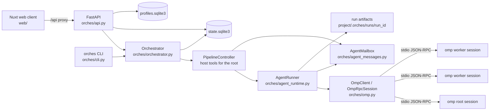
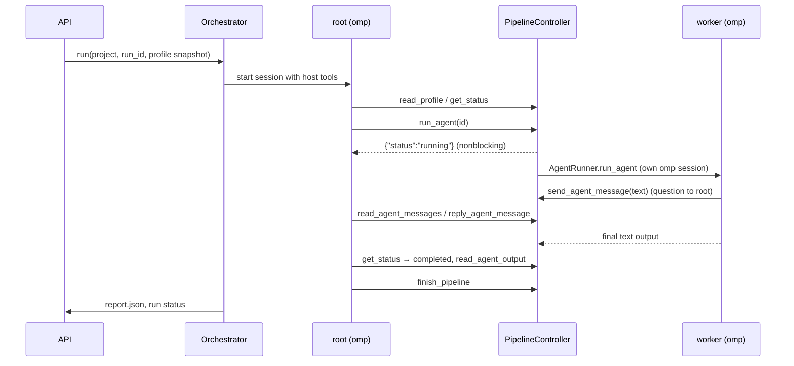

# Architecture

Orches is a local, single-user workspace: a Python backend that drives `omp` agent
sessions, a Nuxt web client that talks to it over `/api/*`, and SQLite for state.
Nothing leaves the machine except the model requests `omp` makes.

## Components

| Module | Responsibility |
| --- | --- |
| `orches/api.py` | FastAPI app: projects, profiles, runs, connections, costs, model catalog. Owns run tasks and the `ActiveSessionRegistry` used for human guidance chat. Local-only (`_require_local`). |
| `orches/cli.py` | `orches api`, `orches projects list`, `orches run start/show`; builds the `Orchestrator` from `orches.toml`. |
| `orches/orchestrator.py` | `Orchestrator.run` executes one run: creates the `PipelineController` and `AgentMailbox`, starts the root session, runs the fatal watchdog, writes `report.json`. |
| `orches/orchestrator.py:PipelineController` | Host-owned DAG state machine exposed to the root as host tools (`read_profile`, `get_status`, `run_agent`, `read_agent_output`, `finish_pipeline`, connection tools, message tools). Enforces dependency order, one start per node, fatal blocking. |
| `orches/agent_runtime.py` | `AgentRunner.run_root` / `run_agent`: launch an `omp` RPC session per invocation, record invocations and artifacts, wire host tools, usage events and the per-run approvals overlay. |
| `orches/omp.py` | `OmpClient.start_session` spawns `omp --mode rpc`; `OmpRpcSession` reads the JSONL event stream, answers `host_tool_call` frames, records usage, supports `steer` / `abort`. |
| `orches/agent_messages.py` | Root ↔ worker inbox (`AgentMailbox`) and the three message host tools. |
| `orches/connection_tools.py` | Connection address-book host tools and the worker approvals overlay. |
| `orches/prompts.py` | Root/worker system prompts and the structured project context. |
| `orches/pipeline_profiles.py`, `orches/profile_store.py` | Profile model (DAG validation, limits, resume helpers) and its SQLite store. |
| `orches/state.py` | `StateStore`: projects, runs, invocations, artifacts, connections and claims, agent messages, cost ledger; schema versioning. |
| `orches/artifacts.py` | Atomic artifact writes with secret redaction and hashing. |
| `orches/costs.py` | Parses `omp` usage events into ledger rows. |
| `web/` | Nuxt 4 + Vue 3 client; Vue Flow canvases. See `front-end-guide.md`. |

## Domain model

- **Profile** — reusable pipeline definition: `steps[]` (each `id`, `name`, `model_selector`,
  `prompt`, `depends_on[]`, `position`, `thinking`) plus `root_prompt`, `root_model`,
  `root_thinking`. Must be a DAG; ≤64 nodes. Saved with optimistic `revision`.
- **Project** — a name bound to an existing local folder (`.orches/project.json` marker),
  with objective, initial brief and the selected profile. One current run at a time; older
  terminal runs are pruned when a new one starts.
- **Run** — immutable snapshot of the profile at start time, one `root` invocation plus one
  invocation per node, status `running | completed | failed | blocked`.
- **Invocation** — one `omp` session: role, model, effort, status, timestamps, stdout/stderr
  artifacts, final `output_json`, model usage.
- **Connection** — address-book entry; may be claimed exclusively by one live invocation.
- **Agent message** — question or reply between the root and a worker of the same run.

## Run lifecycle

Key rules enforced by the host, not by prompts:

- A node starts only when every dependency is `completed`, and only once.
- The root never sees worker credentials or runs shell commands; workers get file tools
  only (`read`, `write`, `edit`, `glob`, `grep`, `todo`, `web_search`) under
  `--approval-mode write`.
- A failed worker makes the run unwinnable: `run_agent` and `finish_pipeline` are refused,
  in-flight workers finish, the root gets a grace window, then it is aborted and the run
  ends `blocked`.
- Cancelling a run aborts the root task; worker sessions are closed and the run ends
  `failed` / `run cancelled`.

## Host tools

Host tools are JSON-schema functions advertised to an `omp` session via `set_host_tools`;
`omp` emits `host_tool_call` frames and the host answers with `host_tool_result`. Workers run
with a per-run `worker-approvals.yml` overlay that allows exactly the advertised host tools.

| Audience | Tools |
| --- | --- |
| Root only | `read_profile`, `get_status`, `run_agent`, `read_agent_output`, `finish_pipeline`, `send_agent_message(to, text)` |
| Workers only | `send_agent_message(text)` (always to the root) |
| Both | `reply_agent_message`, `read_agent_messages`, `read_connections`, `claim_connection`, `release_connection`, `reveal_connection` |

## Storage

| Store | Location | Contents |
| --- | --- | --- |
| State DB | `.orches/state.sqlite3` under the repo (or `[runtime] state_db`) | projects, runs, invocations, artifacts, connections, claims, agent messages, cost ledger, node layout |
| Profiles DB | `~/.orches/profiles.sqlite3` (or `[runtime] profiles_db`) | reusable profiles |
| Run artifacts | `<project folder>/.orches/runs/<run_id>/` | `raw/*.stdout.jsonl`, `raw/*.stderr.txt`, `report.json`, `worker-approvals.yml` |
| Sessions | `<project folder>/.orches/sessions/<run_id>/` | root `omp` session directory |

Schema upgrades are applied on startup (`StateStore._initialize`, `SCHEMA_VERSION`); data from
the previous fixed-role product is discarded on first start except saved connections.

## Security boundaries

- The API binds to localhost and rejects non-local requests; there is no authentication.
- Credentials live in plaintext in the state DB and are returned only by an explicit
  `reveal_connection` call from the claim owner or the local `/cred` route.
- Everything an agent writes (artifacts, messages) passes through `ArtifactStore.redact_text`.
- Project data, worker outputs, chat and agent messages are presented to models as untrusted
  data; prompts say so explicitly.
